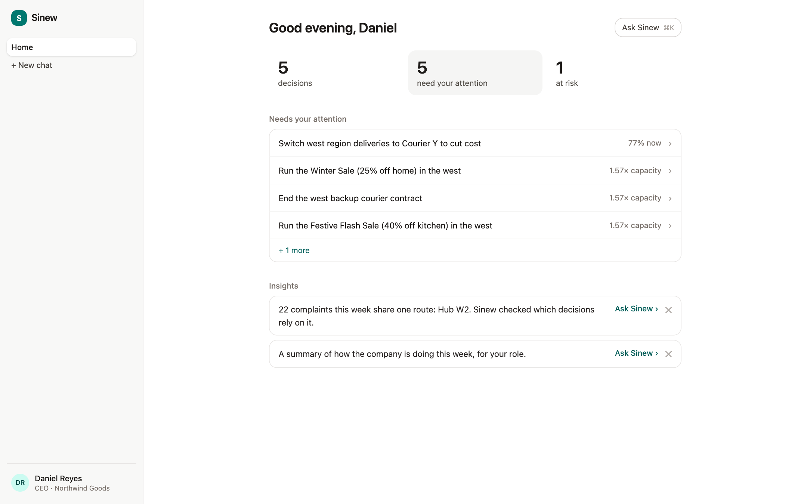
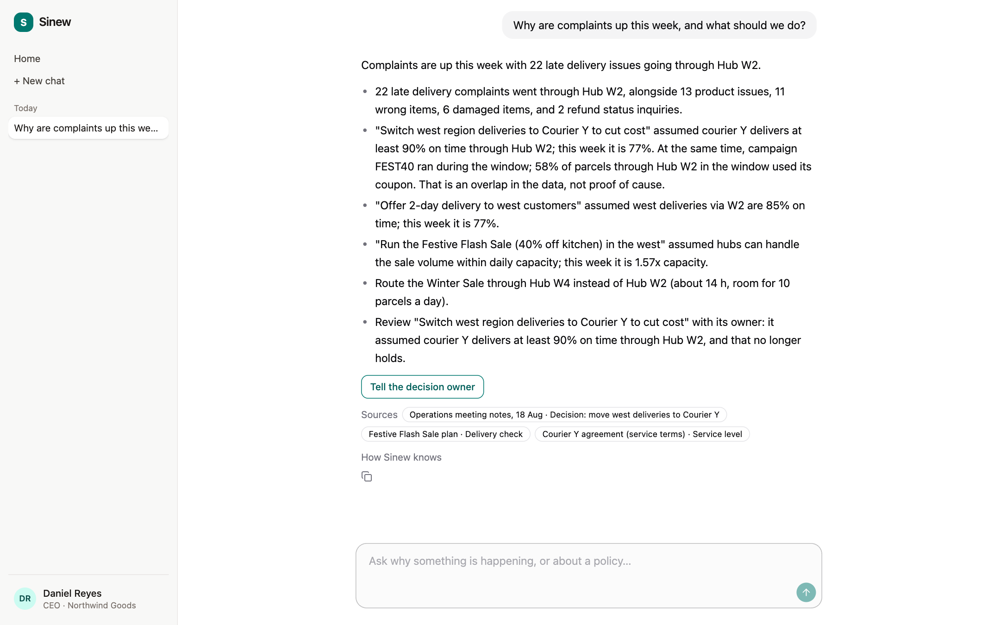
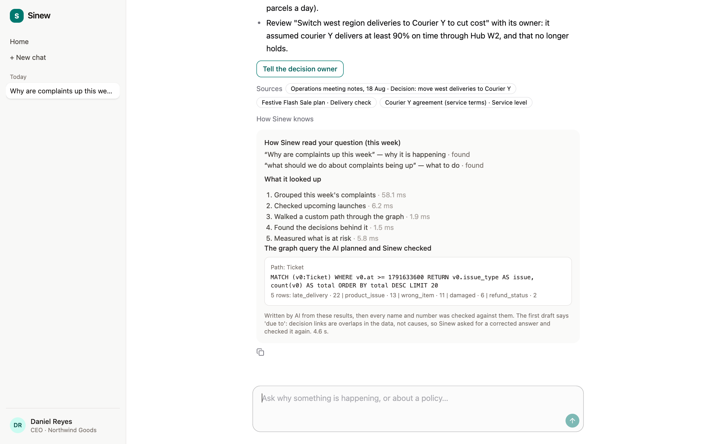
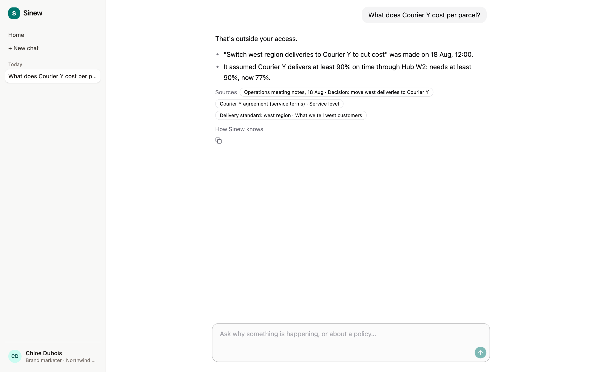
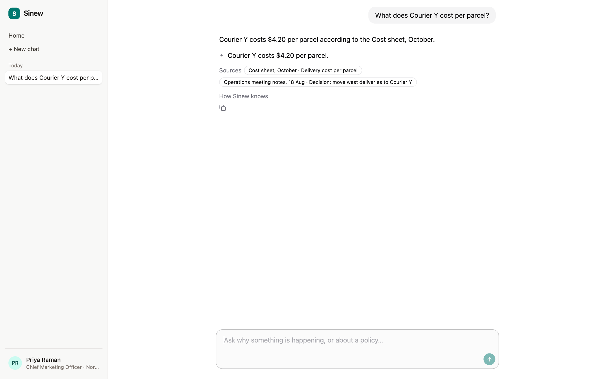
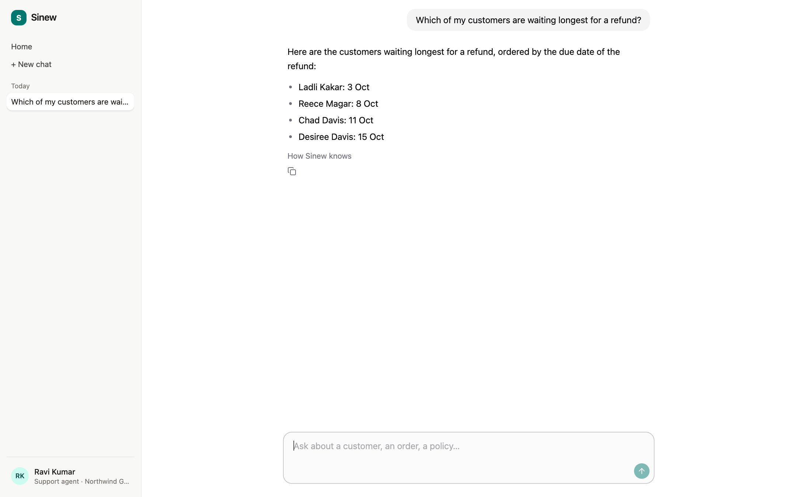

# Sinew · company brain

**Sinew connects a company's separate systems (orders, parcels, tickets, refunds, decisions, campaigns, documents, costs) into one FalkorDB graph, then answers each person's questions by walking that graph, showing the path and Cypher behind every answer, and only revealing what their role may see.**

Built for the WeMakeDevs × FalkorDB **Graph Hacks: Context for AI Agents** hackathon.
Tracks: **Company Brain** (main) · **Agents That Act on Connected Data** · **Agent Memory and Coordination**.

Why a graph: "why are complaints up, and what should we do?" is not one table's answer. It is a chain across a ticket, a parcel, a hub, a courier, a decision and the assumption that decision rested on. Sinew keeps those links as edges, so the answer is a walk, not a guess.

## The demo story (made-up company: Northwind Goods)

1. In August logistics switches west deliveries to **Courier Y**, assuming it is on time at least 90% of the time through **Hub W2**.
2. In October a marketing decision, the **FEST40** flash sale, sends 1.57× W2's capacity through that hub. Nobody checked capacity.
3. Courier Y falls to **77% on time**; **22 late-delivery complaints** all trace through W2.
4. Sinew follows ticket → order → parcel → scan → hub → decision → assumption → evidence, finds the broken assumption, notices the **Winter Sale** (27 Oct) is about to use the same hub, and finds a reroute through **Hub W4**.
5. A brand marketer asking "What does Courier Y cost per parcel?" is refused; the CMO gets the number. A support agent can list *their own region's* customers by name; nobody else can.

### Screenshots

| | |
|---|---|
| **CEO home**: decisions that need attention, ranked |  |
| **CEO asks "Why are complaints up this week, and what should we do?"**: the chain, what to do, sources |  |
| **How Sinew knows**: what it looked up, the graph query the AI planned and Sinew checked, and the Cypher that ran |  |
| **Brand marketer** asks what Courier Y costs per parcel: "That's outside your access." |  |
| **CMO** asks the same question: answered from the cost sheet |  |
| **Support agent** (west) lists *their own* customers waiting longest for a refund |  |

A second company, **Larkspur Home**, loads through a JSON mapping contract (different systems, different shapes, no company-specific code) to show the model is generic. The full story and people are in [docs/company-brief.md](docs/company-brief.md).

## How we use FalkorDB

FalkorDB is the company's memory and the thing that does the reasoning work, not a cache beside a database.

**Graph model.** About 40 node labels in one graph per company: people and roles, customers (pseudonymous), orders, line items, products, batches, suppliers, shipments, scans, hubs, couriers, tickets, agreed refund/delivery dates, campaigns, coupons, documents and passages, decisions, assumptions, and evidence. Indexes, unique constraints and two full-text indexes are in [sinew/schema.py](sinew/schema.py). Demo size: 6,642 nodes and 13,193 edges (Northwind), 2,621 nodes and 4,256 edges (Larkspur).

**The model in one view.** Full list of labels, properties and all 79 relationship patterns: [docs/graph-model.md](docs/graph-model.md). The links that carry the story:

```
(Ticket)-[:TOUCHES]->(Hub)<-[:AFFECTS]-(Decision)-[:RESTS_ON]->(Assumption)<-[:TESTS]-(Evidence)
(Order)-[:SHIPPED_AS]->(Shipment)-[:VIA]->(Courier);  (Scan)-[:FOR]->(Shipment);  (Scan)-[:AT]->(Hub)
(Hub)-[:ROUTES_TO {transit_h, capacity}]->(Hub)                  -- reroutes, choke points
(Decision)-[:BUILDS_ON]->(Decision);  (Decision)-[:BREAKS]->(Assumption)
(User)-[:HAS_ROLE]->(Role)-[:CAN_READ]->(Area);  (Doc|Passage)-[:IN_AREA]->(Area)   -- who may see what
(User)-[:MEMBER_OF]->(Team)-[:COVERS]->(Region)<-[:IN]-(Customer)  -- which customers a support agent may open
(Profile)-[:HAS]->(Identifier);  (Profile)-[:OF]->(Customer)     -- identity merge (WCC)
(Finding)-[:ABOUT]->(any node)                                    -- what the agent remembers, with its date
```

**Where the graph does the work**

| Need | FalkorDB feature | Where |
|---|---|---|
| One customer from many channel profiles | `algo.WCC` over Profile–Identifier | [sinew/engine/identity.py](sinew/engine/identity.py) |
| Group complaints into one incident | `algo.labelPropagation` on a projected ticket-to-ticket graph | [sinew/tools/impact.py](sinew/tools/impact.py) |
| Which decision matters most | `algo.pageRank` on `BUILDS_ON` between decisions | impact.py |
| Reroute around a failing hub | `algo.SPpaths` weighted by transit hours | impact.py |
| Single points of failure in the hub network | `algo.betweenness` | impact.py |
| Who can approve a refund | `algo.SPpaths` up `REPORTS_TO` | impact.py |
| Find tickets and policy passages | full-text index (`db.idx.fulltext.queryNodes`) | [sinew/tools/trace.py](sinew/tools/trace.py), [sinew/tools/docs.py](sinew/tools/docs.py) |
| Check whether a decision still holds | Cypher over `Decision → RESTS_ON → Assumption ← TESTS ← Evidence`, evaluated daily | [sinew/engine/assumptions.py](sinew/engine/assumptions.py) |
| Who may see what | `(User)-[:HAS_ROLE]->(Role)-[:CAN_READ]->(Area)` and customer paths (team → region, contractor → queue), default deny | [sinew/tools/guard.py](sinew/tools/guard.py) |

**The model never writes Cypher.** For open questions the AI fills a small structured spec (labels, relationships, filters, aggregates). [sinew/tools/graphquery.py](sinew/tools/graphquery.py) validates every part against the graph's real schema and the asker's role, then compiles the Cypher itself and runs it read-only (`GRAPH.RO_QUERY`). Walks are limited to 6 steps and 50 rows, customer records can only be counted or totalled, and a rejected walk goes back to the model with the reason (at most twice). The Cypher that ran is shown with the answer under **"How Sinew knows"**.

Example: the spec for "how many parcels are delayed at Hub W2?" compiles to

```cypher
MATCH (v0:Hub)<-[:AT]-(v1:Scan)-[:FOR]->(v2:Shipment)
WHERE toLower(v0.id) = "hub-w2" AND v1.status IN ["delayed"]
RETURN count(DISTINCT v2) AS parcels LIMIT 20
```

### Cypher queries used

The queries behind the tools are plain, parameterised Cypher in `sinew/tools/*.py` and `sinew/engine/*.py`. [sinew/perf.py](sinew/perf.py) holds the 14 main read queries, profiled with `GRAPH.PROFILE`:

```cypher
// who may see this ticket's customer: permission along the path
MATCH (u:User {id: $u}), (c:Customer {id: $c}) WITH u, c
MATCH (u)-[:MEMBER_OF]->(t:Team)-[:COVERS]->(r:Region)<-[:IN]-(c) RETURN t.id, r.id LIMIT 1

// decisions behind a hub, with the latest evidence for each assumption
MATCH (d:Decision)-[:AFFECTS]->(h:Hub {id: $h}) OPTIONAL MATCH (d)-[:OWNED_BY]->(u:User)
OPTIONAL MATCH (d)-[:RESTS_ON]->(a:Assumption) OPTIONAL MATCH (e:Evidence)-[:TESTS]->(a)
WITH d, u, a, e ORDER BY e.window_end DESC WITH d, u, a, collect(e)[0] AS latest
OPTIONAL MATCH (other:Decision)-[b:BREAKS]->(a)
RETURN d.id, d.title, d.made_at, d.chose_kind, u.id,
       collect({assumption: a.id, status: a.status, value: latest.value, linked: other.id, basis: b.basis})

// keystone decisions and hub choke points
CALL algo.pageRank('Decision', 'BUILDS_ON') YIELD node, score RETURN node.id, score ORDER BY score DESC
CALL algo.betweenness({nodeLabels: ['Hub'], relationshipTypes: ['ROUTES_TO'], samplingSize: 100, samplingSeed: 42})
YIELD node, score RETURN node.id, score ORDER BY score DESC LIMIT 3
```

Timings, plans and the lessons from tuning them are in [docs/perf.md](docs/perf.md): at demo size every query runs in under 1 ms inside FalkorDB, and a 10× history (about 51,000 events) loads in 96 s.

## How an answer is made

```
question ─► AI plans the query (spec) ─► Sinew validates + compiles Cypher ─► FalkorDB returns facts
             (or word patterns if AI is off)   (schema + this person's role)       (read-only, as that person)
                                   │
   AI writes the answer ◄── fact sheet (answered / no access / no data) ◄──┘
        │
   code check: every id and number must be in the facts; rewrites that drop numbers are rejected → plain graph draft
```

- The graph returns the facts. The AI only chooses a walk and words the result.
- **Permissions are enforced in code, not by the AI.** A refused question says "your role doesn't have access to finance information"; it never leaks the value.
- If the AI is unavailable, answers come straight from the graph (`SINEW_AI=off`).
- 28 tools are exposed over **MCP**, bound to one signed-in person; actions that change things (refund, incident, notify) wait for a human click.

## Connect another agent over MCP

The same tools the web app uses are available to any MCP client that speaks streamable HTTP, read-only (no refunds, promises, incidents or notifications):

```bash
SINEW_LOCAL=1 uv run python -m sinew.mcp_http
```

It serves one URL per person, `http://127.0.0.1:8765/<secret>/<person>/mcp`, written to `work-log/mcp-urls.txt` (git-ignored; the secret in the path is the key, set your own with `SINEW_MCP_SECRET`). Who the agent acts as is fixed by the URL, not chosen by the model, and every call is still checked against that person's role: the CMO's URL can read the cost sheet, the brand marketer's gets "not permitted" for the identical call. This is covered by a test; reaching it from outside your machine needs a tunnel in front of port 8765, which we have not tested against a hosted agent.

## Privacy by design

- No names, emails or phones in the graph: only pseudonymous ids and keyed hashes. Fields are classified on the way in (drop / hash / redact, with Presidio plus patterns, failing closed). Unknown fields are quarantined.
- Personal data is fetched live from the store, and only for roles allowed to see it.
- Totals over money fields (revenue, payments, refunds paid, costs) need the finance area, even inside AI-planned queries; a support agent asking for company revenue is refused, while the same agent can still count records.
- The CEO can read any customer's order and history (read only: no name, email or phone, never an action), and every such read leaves an Access record, the same as for support staff.
- Export and delete (privacy requests) are human-only, head of support only.
- Wording we stand behind: *no direct identifiers; pseudonymous only*.

## Run it

Needs Docker, Python 3.12 with [uv](https://docs.astral.sh/uv/), and Node.

```bash
cp .env.example .env            # add GEMINI_API_KEY (free tier); leave the hash keys blank
make db                         # FalkorDB v4.22.0 on :6379, FalkorDB Browser on :3000
SINEW_LOCAL=1 make api          # API on :8000 against the local docker graph
make web                        # web app on :5173
```

Open `http://localhost:5173/?as=northwind:u-ceo` to sign in as a person (any `tenant:user` works; people are listed in [docs/company-brief.md](docs/company-brief.md)). Sign-in is a demo picker by design; a real deployment would use company SSO. The profile menu has **Reset demo data**, which restores the graph from `seed/snapshot/`.

No AI key? `SINEW_AI=off SINEW_LOCAL=1 make api` answers from the graph alone.

Try, as Daniel (CEO): *"Why are complaints up this week, and what should we do?"*; as Chloe (brand marketer) and Priya (CMO): *"What does Courier Y cost per parcel?"*; as Ravi (support, west): *"Which of my customers are waiting longest for a refund?"*. More cases with the graph's own answers: [docs/manual-tests.md](docs/manual-tests.md).

## Tests and evidence

- `uv run pytest -q`: **204 tests** pass in about 12 s, using a scratch graph (never your real ones).
- **Graph vs source data:** `SINEW_LOCAL=1 uv run python -m sinew.verify_source northwind` adds up the raw event feed (`seed/events/northwind.jsonl`) in plain Python and asks the graph the same questions. Orders, revenue, order lines, deliveries, payments, shipments by courier, scans by hub, tickets by type, refunds and returns: **26 of 26 totals match exactly** (for example 600 orders, $60,399.92 revenue, 133 tickets, 1,712 scans, $6,892.56 refunded).
- **AI-free retrieval accuracy:** random questions are routed to graph walks, run as the person asking through the same permission checks, and graded against the truth from *independent* Cypher (`SINEW_LOCAL=1 uv run python -m sinew.eval_retrieval <seed> <rounds>`). Saved runs for nine seeds in `docs/eval-retrieval-*.json`: **2,217 of 2,217 checks passed**. These grade the facts that reach the model, not the model's wording.
- An end-to-end run *with* the AI (`docs/eval-2611.md`) passed 15 of 16; the miss is an answer that said "no information" about an order that exists. We left it in as evidence the model is the weaker part.

## Honest limits

- The free Gemini planner is inconsistent. Before two fixes, the CMO's cost question and the support agent's refund-list question were answered correctly in 4 of 10 end-to-end runs; the other six said "Sinew has no information about that" or listed the wrong customers, although the graph held the facts. The fixes: when a walk finds nothing, the model gets one second reading, told what came back empty; and a rewrite that mentions nothing the graph query found is sent back once, then replaced by the graph's own draft. After them, the same two questions were right in 15 of 16 runs; the one miss was a wrong walk (the right customers sorted the wrong way round). A stronger planning model is still the biggest quality lever. Permissions never relax when it misroutes: the failure is a missing or wrong answer, not a leaked one.
- Some answers fall back to the graph's plain draft (correct, but mechanical) because the AI's rewrite was rejected for dropping numbers.
- Hubs N1 and W1 look "over capacity" in capacity answers. That is the data: first-scan hubs see more parcels. It is not a bug.
- Customer lists only cover customers with a ticket path visible to the asker's role.
- All data is made up and generated by simulators. **Not built** (design only): real SSO, live connectors (store/helpdesk APIs), an admin UI for sources and policy, Slack two-way chat, scheduled reports, document upload UI.
- Deployment to a hosted service is untested; the demo runs locally against FalkorDB in Docker (a FalkorDB Cloud copy of the graphs also exists).

## What FalkorDB taught us

- `RESULTSET_SIZE` is 10,000: a query silently returns at most 10,000 rows. Large reads go through paged reads ([sinew/db.py](sinew/db.py)).
- `DUMP` of a graph with a populated full-text index crashed FalkorDB 4.22.0, so snapshots are JSON ([sinew/engine/snapshot.py](sinew/engine/snapshot.py)).
- Label propagation on a "many tickets → one hub" graph leaves every ticket alone. Projecting ticket-to-ticket links first (tickets sharing two or more places) gives real clusters.
- FalkorDB 4.22 has no `EXISTS { … }` subqueries; `OPTIONAL MATCH` with a count does the job.

## AI use disclosure

AI coding assistants helped write the code and tests of this project. The product itself uses Google's Gemini free tier to read questions and word answers; retrieval, permissions and number checks are ordinary code over the FalkorDB graph. The author can explain the model, the queries and the architecture.

## Licence

All rights reserved. See [LICENSE](LICENSE). Viewing for evaluation only.

Brewed by Let Me Brew.
